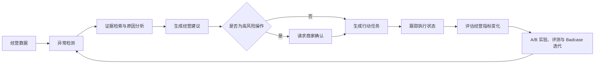

# 商智 AI 经营顾问


[在线体验](https://shangzhi-ai-advisor.shangzhi-ai.workers.dev/) ·
[商家经营端](https://shangzhi-ai-advisor.shangzhi-ai.workers.dev/merchant) ·
[AI 产品运营后台](https://shangzhi-ai-advisor.shangzhi-ai.workers.dev/ops)

面向本地生活商家的 AI 产品经理原型项目。项目没有正式上线，也没有使用真实
商家数据；经营指标、访谈、实验结果、行业基准和评测案例均为模拟数据，用于
展示完整产品方法和可运行的 Agent 交互。

## 项目用途

商智不是一个只会回答问题的聊天机器人，而是一套从“发现经营问题”到
“推动商家完成行动”、再到“评估 AI 是否真正创造业务价值”的产品原型。

它主要用于：

- **AI 产品经理求职作品集**：完整展示需求调研、场景拆解、PRD、Prompt
  策略、Agent 设计、A/B 测试、指标体系、模型评测和 Badcase 迭代能力；
- **商家经营顾问场景演示**：演示 AI 如何读取经营指标、识别异常、解释原因、
  给出可执行建议，并把建议转成有完成状态的经营任务；
- **Agent 原型验证**：验证规划、工具调用、短期记忆、流式对话、风险确认、
  降级回退等关键机制；
- **团队沟通与教学**：可用于面试讲解、产品评审、技术方案讨论和 AI 产品学习。

本项目当前是作品集与可运行 Demo，不接入真实商家后台，也不应直接用于真实
经营决策。后续接入订单、流量、评价、营销和库存等授权数据后，才具备生产化基础。

## 核心功能

| 使用角色 | 核心功能 | 解决的问题 |
| --- | --- | --- |
| 商家 | 经营总览、AI 对话诊断、经营机会、今日任务、商圈竞品 | 看懂数据、找到原因、知道下一步做什么 |
| AI 产品与运营 | 沟通漏斗、A/B 实验、Prompt 策略、标注评测、Badcase、版本对比、运行监控 | 判断 AI 是否有效、安全、稳定并持续提升 |
| 算法与工程 | LangGraph 编排、工具调用、记忆、人工确认、Guardrail、流式 API、失败回退 | 让 Agent 可控制、可评测、可追踪 |

### 商家经营端

- 汇总营收、订单、到店转化率、评分等本店经营指标；
- 发现异常和经营机会，展示判断依据、影响范围及建议优先级；
- 通过 AI 顾问继续追问原因、查看证据并生成优化方案；
- 将建议转成任务，跟踪待执行、执行中和已完成状态；
- 对预算调整、活动发布等高风险操作设置商家二次确认；
- 展示商圈同类门店的模拟基准，不泄露其他商家的私有经营数据。

### AI 产品运营后台

- 监控“消息送达 → 阅读 → 回复 → 接受建议 → 执行 → 指标改善”的完整漏斗；
- 设计和比较不同开场话术、Prompt 或策略的 A/B 实验；
- 按准确性、数据引用、可执行性、行业适配、幻觉、安全等维度评测模型；
- 管理标注任务，查看标注进度、一致性和严重错误；
- 对 Badcase 进行分类、根因分析、修复、回归测试和版本闭环；
- 监控调用量、成本、延迟、工具成功率、回退率和人工确认率。

### Agent 与工程能力

- FastAPI 提供流式对话与确认接口，前端不直接暴露模型密钥；
- LangChain 与 LangGraph 负责规划、工具选择、状态流转和多步骤任务编排；
- 工具层提供经营数据查询、证据检索、方案生成和任务创建；
- SQLite 保存会话记忆，Guardrail 检查数据引用、越权操作和效果承诺；
- 未配置真实模型时显示 `DEMO`，服务异常时显示 `FALLBACK`，不伪装成真实结果。

## 产品闭环



## 产品全景

### 1. 项目首页

说明产品定位、双角色边界、产品架构以及作品集交付物。

[](https://shangzhi-ai-advisor.shangzhi-ai.workers.dev/)

### 2. 商家经营端

面向单店商家，展示本店经营数据、AI 诊断建议、行动任务和商圈竞品。

[](https://shangzhi-ai-advisor.shangzhi-ai.workers.dev/merchant)

### 3. AI 产品运营后台

面向内部产品、算法和运营团队，展示沟通漏斗、A/B 实验、模型评测、
Badcase、版本对比与运行监控。

[](https://shangzhi-ai-advisor.shangzhi-ai.workers.dev/ops)

网站按真实角色拆成三个入口：

- `/`：项目介绍、产品边界、产品架构和作品集资料；
- `/merchant`：模拟商家经营端，只展示本店经营数据、AI 建议、任务和商圈竞品；
- `/ops`：AI 产品内部运营后台，展示汇总漏斗、实验、评测、Badcase 和运行监控。

Python 后端位于 `python_shangzhi/`，使用 FastAPI、LangChain、LangGraph、
OpenAI Responses API、SQLite 记忆和人工确认门。

面向 AI Agent 策略产品岗位，项目额外包含：

- 规划、工具调用、记忆、对话体验四类能力评测；
- Badcase 分类、根因定位、修复方案与回归闭环；
- 当前版本、历史版本与无工具基线的统一任务评测；
- 调用量、成本、延迟、工具健康、回退和人工确认监控。

## Prerequisites

- Node.js `>=22.13.0`

## 启动完整前后端

macOS 可直接双击根目录的 `启动完整项目.command`，它会安装缺少的依赖、
同时启动完整前端和 Python Agent，并打开 `http://127.0.0.1:3000`。
需要启用真实模型时，先双击 `配置大模型.command` 写入后端密钥。

也可以分别手动启动：

```bash
npm install
npm run dev
```

另开终端启动 Python Agent：

```bash
cd python_shangzhi
./启动商智.command
```

在前端根目录创建本地 `.env.local`：

```dotenv
AGENT_API_URL=http://127.0.0.1:8000
```

然后访问 `http://localhost:3000`。浏览器只请求同源 `/api/agent/*`，Vinext
服务端再转发给 Python，因此 OpenAI Key 不会进入前端。

如果没有配置 `AGENT_API_URL`，完整页面仍会以明确标识的 `DEMO` 模式运行；
如果 Python 服务暂时不可用，会显示 `FALLBACK`，不会伪装成真实模型。

## 免费公开部署

登录 Cloudflare 后运行：

```bash
npm run deploy:cloudflare
```

会生成不含 `chatgpt` 字样的免费 `workers.dev` 地址。该部署默认使用 DEMO
Agent；要连接公网 Python LangGraph 服务，需要在 Worker 中配置
`AGENT_API_URL`。

## 构建与测试

```bash
npm run build
npm test
npm run lint
```

## Useful Commands

- `npm run dev`: start local development
- `npm run build`: verify the deployment build
- `npm test`: build and verify the introduction, merchant and operations routes
- `npm run lint`: run frontend code quality checks
- `npm run db:generate`: generate Drizzle migrations after schema changes
