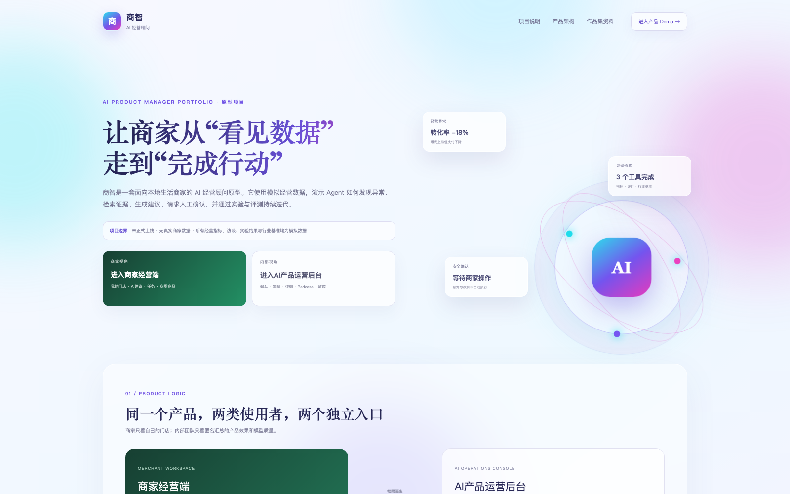
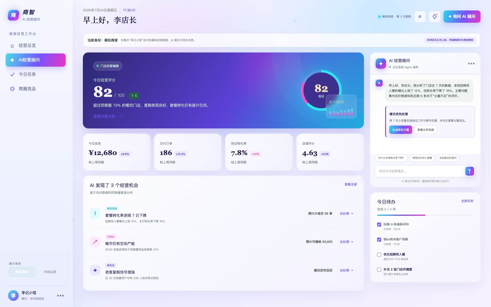
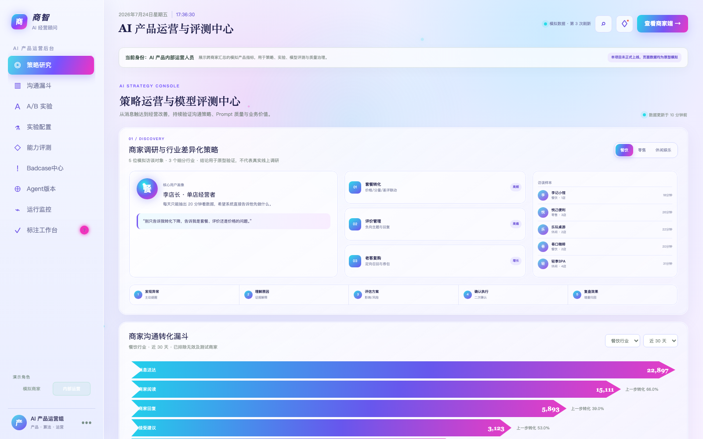

# 商智 AI 经营顾问


[在线体验](https://shangzhi-ai-advisor.shangzhi-ai.workers.dev/) ·
[商家经营端](https://shangzhi-ai-advisor.shangzhi-ai.workers.dev/merchant) ·
[AI 产品运营后台](https://shangzhi-ai-advisor.shangzhi-ai.workers.dev/ops)

面向本地生活商家的 AI 产品经理原型项目。项目没有正式上线，也没有使用真实
商家数据；经营指标、访谈、实验结果、行业基准和评测案例均为模拟数据，用于
展示完整产品方法和可运行的 Agent 交互。

## 产品全景

### 1. 项目首页

说明产品定位、双角色边界、产品架构以及作品集交付物。

[](https://shangzhi-ai-advisor.shangzhi-ai.workers.dev/)

### 2. 商家经营端

面向单店商家，展示本店经营数据、AI 诊断建议、行动任务和商圈竞品。

[](https://shangzhi-ai-advisor.shangzhi-ai.workers.dev/merchant)

### 3. AI 产品运营后台

面向内部产品、算法和运营团队，展示沟通漏斗、A/B 实验、模型评测、
Badcase、版本对比与运行监控。

[](https://shangzhi-ai-advisor.shangzhi-ai.workers.dev/ops)

网站按真实角色拆成三个入口：

- `/`：项目介绍、产品边界、产品架构和作品集资料；
- `/merchant`：模拟商家经营端，只展示本店经营数据、AI 建议、任务和商圈竞品；
- `/ops`：AI 产品内部运营后台，展示汇总漏斗、实验、评测、Badcase 和运行监控。

Python 后端位于 `python_shangzhi/`，使用 FastAPI、LangChain、LangGraph、
OpenAI Responses API、SQLite 记忆和人工确认门。

面向 AI Agent 策略产品岗位，项目额外包含：

- 规划、工具调用、记忆、对话体验四类能力评测；
- Badcase 分类、根因定位、修复方案与回归闭环；
- 当前版本、历史版本与无工具基线的统一任务评测；
- 调用量、成本、延迟、工具健康、回退和人工确认监控。

## Prerequisites

- Node.js `>=22.13.0`

## 启动完整前后端

macOS 可直接双击根目录的 `启动完整项目.command`，它会安装缺少的依赖、
同时启动完整前端和 Python Agent，并打开 `http://127.0.0.1:3000`。
需要启用真实模型时，先双击 `配置大模型.command` 写入后端密钥。

也可以分别手动启动：

```bash
npm install
npm run dev
```

另开终端启动 Python Agent：

```bash
cd python_shangzhi
./启动商智.command
```

在前端根目录创建本地 `.env.local`：

```dotenv
AGENT_API_URL=http://127.0.0.1:8000
```

然后访问 `http://localhost:3000`。浏览器只请求同源 `/api/agent/*`，Vinext
服务端再转发给 Python，因此 OpenAI Key 不会进入前端。

如果没有配置 `AGENT_API_URL`，完整页面仍会以明确标识的 `DEMO` 模式运行；
如果 Python 服务暂时不可用，会显示 `FALLBACK`，不会伪装成真实模型。

## 免费公开部署

登录 Cloudflare 后运行：

```bash
npm run deploy:cloudflare
```

会生成不含 `chatgpt` 字样的免费 `workers.dev` 地址。该部署默认使用 DEMO
Agent；要连接公网 Python LangGraph 服务，需要在 Worker 中配置
`AGENT_API_URL`。

## 构建与测试

```bash
npm run build
npm test
npm run lint
```

## Useful Commands

- `npm run dev`: start local development
- `npm run build`: verify the deployment build
- `npm test`: build and verify the introduction, merchant and operations routes
- `npm run lint`: run frontend code quality checks
- `npm run db:generate`: generate Drizzle migrations after schema changes
