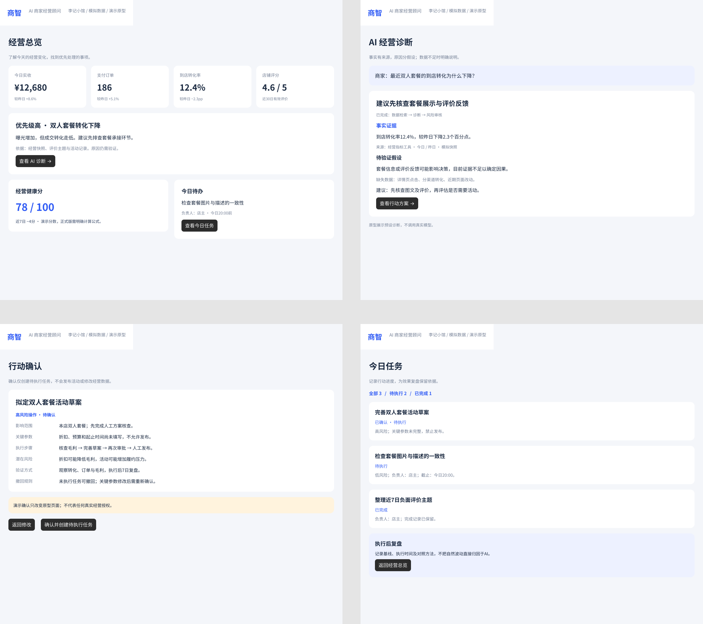

# 商智商家端 Figma 原型

基于商智 PRD v2.0 设计的商家核心流程原型，使用模拟经营数据。

- [Figma 可编辑设计文件](https://www.figma.com/design/QFtFVFFIGuLfA0SlFMJ8Fk?node-id=3-173)
- [交互演示](https://www.figma.com/proto/QFtFVFFIGuLfA0SlFMJ8Fk?node-id=3-173&starting-point-node-id=3%3A173)

## 页面范围

1. 经营总览：经营指标、经营机会、健康分和任务入口。
2. AI 经营诊断：事实证据、原因假设、缺失数据和行动建议。
3. 行动确认：影响范围、关键参数、风险、验证及撤回规则。
4. 今日任务：任务状态、负责人及效果复盘提示。

已配置六处页面跳转。诊断与状态变化均为预设演示，不调用真实模型或执行经营操作。

## 预览

Figma 原生可编辑图层及交互保留在上方设计文件；本目录保存预览图和访问入口，不包含 .fig 二进制源文件。
